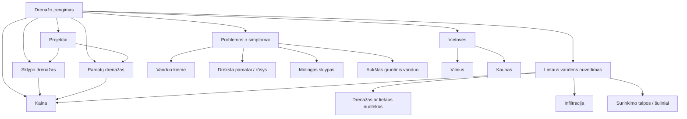
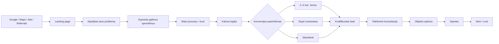
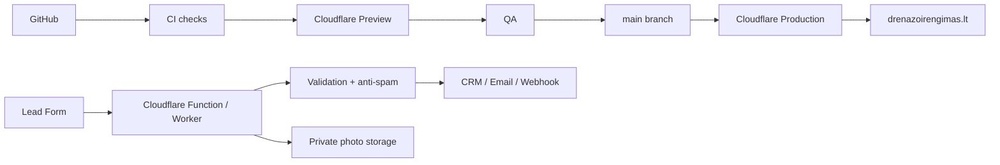

# drenazoirengimas.lt — Lietuvos drenažo rinkos, SEO, CRO ir lead-gen svetainės strategija

## Strateginė išvada ir rinka

**1. Executive summary**

Ši ataskaita vykdo pridėtą `drenazoirengimas.lt` užduotį: pagrindinė paslauga yra sklypo, pamatų ir teritorijos drenažo įrengimas Lietuvoje, prioritetą teikiant Vilniui ir Kaunui, o pagrindinė konversija — kvalifikuota užklausa dėl konsultacijos / sąmatos, papildomai naudojant telefono skambučius ir objekto nuotraukų pateikimą. fileciteturn0file0

Pagrindinė strateginė išvada: **šioje rinkoje nereikia laimėti pažadu „drenažas nuo X €/m“. Reikia laimėti diagnozės, aiškumo ir pasitikėjimo kategoriją.**

2026 m. viešoje Paslaugos.lt drenažo kategorijoje matoma 255 paslaugų teikėjų ir 863 klientų užklausų; skelbiama orientacinė 10–30 €/m kainų amplitudė ir 16 €/m vidurkis. Vilniaus kategorijoje matyti 107 teikėjai ir 264 užklausos, Kauno — 104 teikėjai ir 131 užklausa. Tai nėra visos Lietuvos rinkos dydis, bet aiškiai rodo ir realią paklausą, ir fragmentuotą pasiūlą. Rinka nėra vien „vamzdžio paklojimas“. Tikros užklausos apima apsemtus rūsius, užmirkusį jau apželdintą sklypą, lietaus vandens surinkimą, griovių formavimą, infiltracinius šulinius ir kompleksinį gerbūvį. Vienoje 2026 m. Kauno užklausoje klientas ieškojo skubaus 80–100 m drenažo jau gyvenamame ir apželdintame 7 arų sklype, pageidaudamas mažos technikos; kitoje problema buvo užlietas namo rūsys. Vilniaus užklausose matyti poreikis vienu projektu spręsti drenažą, lietaus nuotekas, reljefo formavimą ir infiltraciją. Todėl optimalus `drenazoirengimas.lt` pozicionavimas:

> **Drenažas be spėlionių. Pirmiausia suprantame, iš kur atsiranda vandens problema ir kur vanduo gali būti tinkamai nuvestas. Tada siūlome sprendimą ir aiškią darbų apimtį.**

Pagrindinis komercinis pranašumas turėtų būti ne „pigiau“, bet penki dalykai:

1. **Diagnozė prieš pasiūlymą.**
2. **Aiški sąmata su įtrauktais ir neįtrauktais darbais.**
3. **Objekto ir esamo gerbūvio apsauga.**
4. **Nuotraukomis dokumentuojami užkasami darbai.**
5. **Labai paprastas pirmas žingsnis — vieta + problema + nuotraukos.**

Tai tiesiogiai atliepia stipriausią rastą klientų atsiliepimą: klientas su molingu gruntu, aukštu gruntiniu vandeniu, neaiškiomis komunikacijomis ir trinkelėmis neigiamai vertino rangovus, kurie neįsigilino, siūlė abejotinus sprendimus arba po apžiūros nebeatsiliepė. Teigiamai buvo vertinama punktualumas, gilesnis problemos nagrinėjimas, sprendimo argumentavimas, aiškus paaiškinimas „kas, kaip ir kodėl“, susitarimas dėl iškasto grunto bei derlingo sluoksnio atskyrimas nuo molio. SEO prasme svetainė neturi būti vienas „drenažo įrengimas“ landingas. Ji turi užimti visą vartotojo problemos kelią:

**problema → diagnozė → sprendimo tipas → kaina → procesas → vieta → įrodymas → užklausa.**

Svarbiausi komerciniai klasteriai:

`drenažo įrengimas`, `sklypo drenažas`, `pamatų drenažas`, `drenažas aplink namą`, `drenažo kaina`, `drenažo įrengimas Vilnius`, `drenažo įrengimas Kaunas`, taip pat problemos kalba — `vanduo kieme`, `šlapias sklypas`, `drėksta pamatai`, `vanduo rūsyje`, `aukštas gruntinis vanduo`, `molingas sklypas`.

Exact-match / labai aiškus `drenazoirengimas.lt` domenas yra semantiškai stiprus prekės ženklo pagrindas, tačiau Google reitingavimui vien domeno nepakanka; konkurencinį pranašumą turės sukurti turinys, realūs projektai, reputacija, techninė kokybė ir geresnė vartotojo patirtis.

**2. Market opportunity**

Lietuvoje yra didelis bazinis adresuojamas individualių namų fondas. 2021 m. surašymo metu šalyje buvo 1,438 mln. įprastinių būstų; vieno buto namų skaičius per 2001–2021 m. išaugo 25,7 %, o 1,122 mln. žmonių, arba 40 % gyventojų, gyveno vieno buto namuose. 91,3 % apgyvendintų būstų buvo gyvenami savininkų. Tai palanki struktūra namo ir sklypo investicijoms, kurių sprendimą priima pats savininkas. Ypač svarbus Vilniaus–Kauno prioritetas. 2011–2020 m. 45,5 % Lietuvoje pastatytų būstų buvo penkiuose didžiuosiuose miestuose, dar 25,2 % — jų rajonuose. Vien Vilniui teko 28,3 %, Kaunui — 9,8 % to laikotarpio naujų būstų. Istorinis statybos srautas taip pat rodo reikšmingą naujų individualių objektų bazę: 2021 m. buvo užbaigta 10 951 nauja gyvenamoji vieta, o 68,3 % jų buvo individualiuose namuose — apie 7,5 tūkst. individualaus namo būstų. Tai nėra 2026 m. prognozė, tačiau tai yra naudinga struktūrinė rinkos dydžio atrama. **Planavimo rinkos dydžio scenarijus.** Lietuvoje nėra viešai identifikuotos oficialios statistinės kategorijos, kuri tiksliai atskirtų privačių sklypų ir pamatų drenažo apyvartą, todėl tikslaus TAM deklaruoti negalima. Modeliuojant pagal maždaug 7 480 individualaus namo būstų metinį istorinį naujos statybos srautą, darant prielaidą, kad reikšmingų drenažo / paviršinio vandens sprendimų prireikia 25–50 % objektų, ir naudojant maždaug 2 500–6 000 € pilnesnio projekto orientyrą, vien naujos statybos segmentas duoda apytikslę **4,7–22,4 mln. €** scenarijaus amplitudę. Prie jos dar prisideda milžiniškai didesnio esamo individualių namų fondo remontas ir problemų šalinimas. Todėl verslo planavimui racionalus **drenažo + artimai susijusio privataus paviršinio vandens valdymo TAM dydžio order-of-magnitude yra maždaug 10–45 mln. €/metus**, bet šio intervalo patikimumas yra žemas–vidutinis ir jo negalima reklamuoti kaip oficialios rinkos statistikos. Baziniai būsto ir kainų įverčiai remiasi oficialia statistika ir viešais rinkos kainoraščiais. Vilnius yra ypač logiška starto rinka. 2026 m. savivaldybė skelbė, kad „Grinda“ tais metais į paviršinių nuotekų infrastruktūrą investuos 15 mln. €, iki 2029 m. — 46 mln. €. Savivaldybės duomenimis, tik apie 25 % Vilniaus turi centralizuotus lietaus nuotekų tinklus, o per stiprias liūtis kai kur susidaro dideli srautai. Tai nėra privataus drenažo rinkos dydis, tačiau patvirtina, kad paviršinio vandens valdymas sparčiai augančiame Vilniuje yra reali infrastruktūrinė problema. **Sezoniškumas.** Tikėtinas dvigubas pikas: problemos suvokimas po pavasario polaidžio ir intensyvių liūčių, o realus montavimas — neužšalusio grunto ir bendro statybų sezono metu. Tai yra rinkos elgsenos išvada, o ne patvirtintas Google Trends mėnesinis indeksas. 2025 m. Lietuvos hidrometeorologijos tarnyba registravo tiek pavojingų meteorologinių, tiek hidrologinių reiškinių, o realios 2026 m. marketplace užklausos vasarą rodo skubų reagavimą į užliejimą ir drėgmės problemas. **Kainų benchmarkai**

| Šaltinis / pozicionavimas | Viešai rodoma orientacija | Ką tai reiškia |
|---|---:|---|
| Paslaugos.lt, Lietuva / Vilnius / Kaunas | 10–30 €/m, vid. 16 €/m | Marketplace lygio kainos; darbų apimtys gali labai skirtis. |
| Lauko inžinerija | ~25–45 €/m; tipinis sodybos projektas ~2 500–6 000 € | Artimesnis kompleksiniam specialistų pasiūlymui nei „tik vamzdis“. |
| Urbkasa | nuo ~10 €/m | Komunikacijoje nurodoma, kad į metrą įtraukiami tam tikri kasimo, vamzdžio ir filtravimo darbai; galutinė kaina vertinama objekte. |
| MB „Drusvita“ / Paslaugos24 | ~25–40 €/m; atskiras pasiūlymas nuo ~32 €/m su medžiagomis | Rodo, kaip kaina išauga, kai į ją įtraukiama platesnė darbų ir medžiagų apimtis. |
| Ldizainas / Landšafto dizainas | aukštesnio biudžeto kompleksiniai sprendimai; pamatų rekonstrukcijos kainos skelbiamos tūkstančiais eurų | Konkuruoja ne vien metro kaina, o pilnu gerbūvio / vandens valdymo sprendimu. |
| 2026 statybos kainų apžvalgos | ~20–45 €/m su filtruojančiais sluoksniais; pamatų drenažas dažnai modeliuojamas ~3 000–8 000 € | Naudoti kaip rinkos orientyrą, ne kaip fiksuotą kainoraštį. |

Svarbi išvada: **10 €/m ir 80 €/m nebūtinai yra konkuruojantys pasiūlymai.** Vienur gali būti skaičiuojamas tik konkretus darbo etapas, kitur — medžiagos, kasimas, skalda, geotekstilė, šuliniai, grunto išvežimas, sudėtingas privažiavimas, dangos atstatymas. Todėl `drenazoirengimas.lt` neturėtų hero zonoje kovoti mažiausia „€/m“ kaina.

Rekomenduojama kainodara:

**„Orientacinė kaina + aiškūs kainą lemiantys veiksniai + individuali sąmata po situacijos įvertinimo.“**

**Lead economics modelis**

Naudinga formulė:

`Qualified lead value = vidutinio projekto pajamos × contribution margin × close rate`

Iliustracinis, o ne rinkos faktu laikytinas scenarijus:

`4 000 € projektas × 30 % contribution margin × 25 % close rate = 300 € tikėtina kvalifikuoto lead vertė.`

Esant tokioms vidinėms verslo metrikoms, 75–120 € CPL galėtų būti racionalus testinis intervalas; tačiau prieš nustatant reklamos biudžetą šiuos 30 % ir 25 % būtina pakeisti faktiniais paslaugos teikėjo margin ir close-rate duomenimis. 4 000 € pavyzdinis ticket dydis patenka į viešuose šaltiniuose matomą kelių tūkstančių eurų pilnesnių sistemų amplitudę. **SWOT**

| | Analizė |
|---|---|
| **Strengths** | Labai aiški niša; domenas tiesiogiai apibrėžia paslaugą; galima sukurti gerokai aiškesnį diagnostinį ir edukacinį UX nei bendrų gerbūvio paslaugų svetainėse. |
| **Weaknesses** | Startuojantis lead-gen brandas savaime neturi realių atsiliepimų, projektų, rangovo istorijos ar vietinio autoriteto; šių dalykų negalima suklastoti. |
| **Opportunities** | Rinka fragmentuota, daug rezultatų yra katalogai ar bendrų statybinių darbų teikėjai; klientams akivaizdžiai trūksta diagnozės, aiškių paaiškinimų ir skaidrios apimties. |
| **Threats** | Marketplace kainų spaudimas, Google Maps dominavimas vietinėse užklausose, sezoniškumas, paslaugos teikėjo pajėgumų svyravimai ir neteisingos techninės / teisinės konsultacijos rizika. |

**3. Customer personas and intent**

Demografijos nereikia išgalvoti. Segmentuoti verta pagal **situaciją ir pirkimo būseną**.

| Persona | Kas įvyko | Intent | Ko reikia iš svetainės |
|---|---|---|---|
| Esamo namo savininkas | Vanduo kieme, drėksta rūsys / pamatai, problema kartojasi po lietaus | Aukštas, kartais skubus | „Kas čia vyksta? Ar tikrai reikia drenažo? Kiek kainuos? Ar nesugadins kiemo?“ |
| Naujo namo savininkas / statytojas | Formuojamas gerbūvis, prieš trinkeles ir veją reikia sutvarkyti vandenį | Planuotas komercinis | Teisinga darbų seka, sprendinio tipas, sąmata, terminai |
| Property manager | Problema kartojasi objekte; reikia patikimo rangovo | Aukštas, racionalus | Dokumentacija, darbų apimtis, garantija, terminas, sąskaita |
| Smulkus developeris | Keli objektai arba naujas projektas | Komercinis / partnerystė | Pajėgumas, projektinis mąstymas, inžineriniai suderinimai, darbų procesas |
| Problem-aware lankytojas | „Vanduo stovi kieme“, „molingas sklypas“ | Informacinis → komercinis | Diagnostika, simptomų turinys, quiz, nuotraukų siuntimas |

Tikros užklausos patvirtina, kad vartotojas ne visada ieško techninio termino „drenažas“. Vienas Vilniaus klientas formuluoja visą problemą kaip lietaus vandens surinkimą, talpas, drenažą, latakus ir gerbūvį; kitas ieško ilgalaikio sprendimo blogai veikiančiam infiltraciniam šuliniui. Todėl svetainėje reikia naudoti abi kalbas:

**Profesionalo kalba:** drenažo vamzdynas, infiltracija, surinkimo šulinys, geotekstilė, drenuojantis sluoksnis, paviršinės nuotekos, nuolydis, gruntinis vanduo.

**Kliento kalba:** vanduo kieme, šlapia veja, klampus molis, drėksta pamatai, semia rūsį, po lietaus balos nedingsta, nėra kur nuvesti vandens.

**4. Customer pain points**

**Emociniai:** baimė, kad problema blogės; nepasitikėjimas rangovu; jausmas „aš nežinau, ar man parduoda tai, ko tikrai reikia“; nerimas dėl jau sutvarkyto kiemo.

**Praktiniai:** nežinoma, iš kur vanduo ateina; kur jį nuvesti; ar galima privažiuoti technika; kaip apeiti komunikacijas; ar reikės ardyti trinkeles; kas bus su gruntu; kiek užtruks.

**Finansiniai:** neaiški galutinė kaina; „nuo X €/m“ neatitinka galutinės sąmatos; grunto išvežimas, papildomi šuliniai, medžiagos, dangos atstatymas ir sudėtingas priėjimas gali būti atskiros eilutės.

**Rizikos:** netinkamai diagnozuota problema; pasirinkta netinkama vandens priėmimo vieta; sistema neužtikrina laukto rezultato; pažeidžiamos esamos komunikacijos ar gerbūvis; darbai atlikti, bet nėra aišku, kas buvo užkasta.

Realiuose klientų duomenyse matyti būtent tokie kontekstai: molis, aukštas gruntinis vanduo, nežinomos komunikacijos, trinkelės, gyvenamas ir apželdintas sklypas bei pageidavimas dirbti mažesne technika. ## Kliento balsas ir konkurencinė aplinka

**5. Review-mining findings**

Viešai indeksuojamų specifinių Lietuvos drenažo Google/Facebook review tekstų tyrimo metu buvo mažiau nei marketplace atsiliepimų ir užklausų; todėl žemiau **nė vienas skundas nėra išgalvotas**. Svarbiausias kokybinis signalas gaunamas iš realios Paslaugos.lt rekomendacijos ir realių 2026 m. klientų užklausų. | Klientas sako / galvoja | Tikrasis rūpestis | Svetainės žinutė | Funkcija / trust signal |
|---|---|---|---|
| „Kiti neįsigilino į situaciją.“ | Bijau neteisingos diagnozės | „Pirmiausia įvertiname problemą, tik tada siūlome sprendinį.“ | Diagnostikos procesas + problemos anketa |
| „Siūlė abejotinus sprendimus.“ | Negaliu įvertinti techninio pasiūlymo | „Paaiškiname, kodėl siūlomas būtent toks vandens kelias.“ | Paprasta schema / cross-section |
| „Po apžiūros dingo.“ | Rangovas nepatikimas | „Po apžiūros gaunate aiškų kitą žingsnį.“ | SLA tik tada, kai tiekėjas realiai gali jo laikytis |
| „Molis, aukštas gruntinis vanduo, komunikacijos, trinkelės.“ | Mano objektas nėra standartinis | „Vertiname gruntą, reljefą, esamą gerbūvį ir komunikacijas.“ | Lead form su situacijos klausimais ir nuotraukomis |
| Patiko, kad paaiškino „kas, kaip ir kodėl“ | Noriu kontroliuoti riziką | „Sprendimas suprantama kalba.“ | Process timeline + objekto dokumentacija |
| Patiko grunto ir derlingo sluoksnio atskyrimas | Bijau sunaikinto kiemo | „Planuojame ne tik kasimą, bet ir objekto apsaugą.“ | „Kaip saugome sklypą“ blokas |
| Klientas prašo mažos technikos apželdintame sklype | Darbo metodas gali būti toks pat svarbus kaip kaina | „Įvertiname priėjimą ir esamą gerbūvį.“ | Formos laukelis „Objektas jau sutvarkytas?“ |

Pagrindinis review-mining insight:

**Klientas perka ne perforuotą vamzdį. Jis perka ramybę, kad kažkas kompetentingai suprato jo konkretaus sklypo vandens problemą ir neišardys turto be aiškaus plano.**

Tai labai stipri copywriting kryptis, nes ji remiasi realiu vartotojo elgesiu. **6. Competitor analysis**

Toliau — ne audituotas didžiausių Lietuvos įmonių apyvartos reitingas, o **stipriausių / dažniausiai tyrimo metu aptiktų organinių ir SERP konkurentų rinkinys**. Google vietinių rezultatų tvarka priklauso nuo vartotojo lokacijos ir kitų signalų, todėl nereikėtų apsimesti turint vieną universalią „top 10 Google Maps“ eilę.

| Konkurentas | Tipas / aprėptis | Stiprybė | Silpnybė / galimybė mums |
|---|---|---|---|
| **Paslaugos.lt** | Marketplace, visa LT | Labai stipri pasiūlos, kainų, review ir užklausų bazė; 2026 m. 255 teikėjai visoje kategorijoje. | Perteklinis pasirinkimas, nevienoda specializacija; `drenazoirengimas.lt` gali būti daug aiškesnis diagnostikos ekspertas. |
| **Lauko inžinerija** | Specialistas | Specializuotas inžinerinis turinys, kainų orientyrai ir kompleksinis požiūris. | Galima konkuruoti geresniu lead flow, problemos diagnostika ir projektų įrodymais. |
| **Urbkasa** | Žemės / drenažo darbai | Aiškus „nuo“ tarifas ir nurodyta, kas gali įeiti į metrą; sąmata po apžiūros. | `drenazoirengimas.lt` gali geriau paaiškinti, kodėl vien €/m kainos neužtenka. |
| **Ldizainas / Landšafto dizainas** | Vilnius, gerbūvis + drenažas | Gilus edukacinis turinys, sistemos tipai, aukštesnio lygio gerbūvio kontekstas. | Platesnis kraštovaizdžio brandas; mūsų svetainė gali būti 100 % orientuota į vandens problemą. |
| **Drenažo meistras** | Specializuotas turinys / Kauno kryptis | Nišinis pavadinimas ir edukacija apie drenažo bei lietaus vandens sprendimus. | Galimybė laimėti UX, nuotraukų diagnostika ir aiškesne konversijos architektūra. |
| **Universalus Meistras** | Kaunas + miestų puslapiai | Turi atskirą drenažo puslapį ir aprašo proceso etapus. | Brandas apima daugybę nesusijusių meistrų kategorijų; net atsiliepimai puslapyje nėra vien drenažo tema. |
| **Detkonas** | Kaunas, inžineriniai tinklai | Aiškiai nurodo lietaus tinklus, drenažą, talpas, techninę kompetenciją ir atestuotus specialistus; nurodo tinklų pridavimą „Kauno vandenims“. | Labiau inžinerinė įmonės svetainė nei homeowner-first diagnostinis funnelis. |
| **Vandenvala** | Visa Lietuva / katalogų matomumas | Ilga patirtis, drenažas ir lietaus sistemos, vieši marketplace rekomendacijų signalai. | Dalis konversijos vyksta katalogo aplinkoje; galima sukurti stipresnę nuosavą vartotojo kelionę. |
| **Dagnis** | Drenažo / lietaus sprendimai | Viešai komunikuoja konsultaciją / objekto vertinimą ir kainą už metrą. | Galima geriau išskaidyti kainą ir diagnostiką vartotojui. |
| **Kasti.lt** | Vilnius / žemės ir inžineriniai darbai | Drenažas ir lietaus vanduo susiejami su platesniais kasimo / komunikacijų darbais. | Platesnis paslaugų katalogas mažina nišinį „vandens problemų eksperto“ pozicionavimą. |

Vienas svarbiausių konkurencinių atradimų yra pačios marketplace struktūros kokybė: Vilniaus „drenažo“ kategorijos rezultatuose tarp aukštai matomų profilių yra trinkelių klojimo, mini ekskavatorių, bendro gerbūvio ir santechnikos paslaugos, todėl vartotojas ne visuomet gauna aiškiai specializuotą pasirinkimą. **7. Competitor weaknesses**

Pasikartojančios spragos:

**Per daug „mes darome drenažą“, per mažai „kaip suprasti, ko reikia būtent jums“.** Net informatyvesni konkurentai dažnai pradeda nuo sistemos aprašymo, o ne nuo vartotojo situacijos. **Kaina pateikiama be pakankamo scope konteksto.** Marketplace rodo 10–30 €/m, o specializuoti šaltiniai ir pilnesni projektai rodo gerokai didesnius skaičius. Tai kuria vartotojo kainos inkaravimo problemą. **Silpnas specialistų ir bendrų meistrų atskyrimas.** Vienos kategorijos SERP konkurentai tuo pat metu reklamuoja trinkeles, ekskavatoriaus nuomą, santechniką ar pilną gerbūvį. **Trust signalai dažnai abstraktūs:** „kokybė“, „patirtis“, „profesionalumas“. Kliento atsiliepimas rodo, kad daug stipresni signalai yra punktualumas, techninis argumentavimas, aiški komunikacija ir rūpestis objekto būkle. **SEO turinyje pasitaiko universalių techninių teiginių.** Drenažo projektai priklauso nuo grunto, reljefo, pamatų, vandens šaltinio ir teisėtos / techniškai tinkamos priėmimo vietos, todėl `drenazoirengimas.lt` turėtų vengti supaprastintų „visada reikia X gylio“ rekomendacijų.

**8. Differentiation opportunities**

Rekomenduojamas brand promise:

> **Ne pradedame kasti. Pirmiausia suprantame, kodėl sklype kaupiasi vanduo.**

USP versija:

> **Drenažas be spėlionių — situacijos įvertinimas, aiškiai paaiškintas sprendimas ir sąmata, kurioje matote, už ką mokate.**

Penkios diferencijavimo sistemos:

**Diagnosis-first.** Svetainė neapsimeta, kad kiekvienai balai reikia drenažo.

**Water-path thinking.** Aiškinama ne vien kur dedamas vamzdis, bet iš kur vanduo ateina → kaip surenkamas → kur patenka.

**Quote transparency.** Sąmatoje atskiros kategorijos: kasimas, vamzdynas, filtravimo sluoksnis, šuliniai, išvežimas, dangos ardymas / atstatymas, papildomi darbai.

**Buried-work proof.** Rekomenduojama klientui pateikti nuotraukų rinkinį prieš užpilant tranšėjas: trasos, vamzdžiai, jungtys, filtravimo sluoksnis, šuliniai. Tai mūsų siūlomas trust produktas, o ne konkurentų rinkoje patvirtintas standartas.

**Property-care protocol.** Prieš darbą susitariama dėl privažiavimo, grunto kaupimo, augalinio sluoksnio, trinkelių / vejos apsaugos ir atkūrimo. Šis procesas tiesiogiai atliepia realų review signalą. ## Paieška, SEO ir informacijos architektūra

**9. Keyword map**

Viešai patikimų tikslių Lietuvos mėnesinių Google Keyword Planner apimčių tyrime nebuvo gauta, todėl **paieškos apimtys nėra išgalvojamos**. „N/D“ žemiau reiškia, kad prieš reklamos ar content ROI planą konkretūs skaičiai turi būti eksportuoti iš Google Keyword Planner; po paleidimo realius impressions reikia imti iš Search Console. Rinkos paklausos proxy yra marketplace užklausos: šiuo metu viešai matoma 863 užklausų bazė visoje Paslaugos.lt kategorijoje, 264 Vilniuje ir 131 Kaune. | Keyword / klasteris | Intent | LT monthly volume | Prioritetas | Tikslinis URL |
|---|---|---:|---|---|
| drenažo įrengimas | Transactional | N/D | **P1** | `/` |
| drenažo sistemos įrengimas | Commercial | N/D | P1 | `/` |
| sklypo drenažas | Commercial | N/D | **P1** | `/sklypo-drenazas/` |
| pamatų drenažas | Commercial | N/D | **P1** | `/pamatu-drenazas/` |
| drenažas aplink namą | Commercial / informational | N/D | P1 | `/pamatu-drenazas/` |
| drenažo įrengimas kaina | Price | N/D | **P1** | `/drenazo-kaina/` |
| drenažo kaina už metrą | Price | N/D | P1 | `/drenazo-kaina/` |
| drenažo įrengimas Vilnius | Local transactional | N/D | **P1** | `/drenazas-vilniuje/` |
| drenažo įrengimas Kaunas | Local transactional | N/D | **P1** | `/drenazas-kaune/` |
| vanduo kieme po lietaus | Problem-aware | N/D | P2 | `/vanduo-sklype/` |
| šlapias / užmirkęs sklypas | Problem-aware | N/D | P2 | `/vanduo-sklype/` |
| drėksta pamatai | Problem-aware | N/D | P2 | `/pamatu-drenazas/` |
| vanduo rūsyje | Problem-aware | N/D | P2 | `/pamatu-drenazas/` |
| molingas sklypas vanduo | Problem-aware | N/D | P2 | `/vanduo-sklype/` |
| aukštas gruntinis vanduo | Information → commercial | N/D | P2 | problemų hub |
| drenažas ar lietaus kanalizacija | Comparison | N/D | P2 | `/drenazas-ar-lietaus-nuotekos/` |
| kur nuvesti drenažo vandenį | Informational / risk | N/D | P2 | guide + FAQ |
| ar reikia drenažo aplink namą | Question | N/D | P2 | `/pamatu-drenazas/` |
| kiek trunka drenažo įrengimas | Question | N/D | P3 | FAQ / process |
| drenažo remontas / valymas | Commercial adjacent | N/D | P3 | kurti tik jei realiai teikiama |
| lietaus vandens nuvedimas | Commercial adjacent | N/D | P1/P2 | `/lietaus-vandens-nuvedimas/` |

Semantic entities: `gruntinis vanduo`, `paviršinis vanduo`, `lietaus nuotekos`, `pamatai`, `hidroizoliacija`, `molingas gruntas`, `nuolydis`, `perforuotas vamzdis`, `geotekstilė`, `skalda / žvyras`, `surinkimo šulinys`, `infiltracija`, `lietaus vandens talpa`, `reljefas`, `tranšėja`.

Svarbu nepadaryti klasikinės SEO klaidos — nekurti atskirų plonų puslapių `drenazas-trakuose`, `drenazas-elektrenuose`, `drenazas-jonavoje` ir t. t. vien pakeičiant miesto pavadinimą. Vilniui ir Kaunui atskiri puslapiai racionalūs tik todėl, kad tai prioritetinės realios rinkos; kiti miestai turėtų atsirasti tik turint unikalių projektų, komandą, aptarnavimo informaciją ir tikrą vartotojo vertę.

**10. Search-intent map**

Šviežias organinių rezultatų tyrimas rodo mišrią konkurenciją: specialistų svetaines, marketplace / katalogus, bendrus statybos rangovus ir edukacinius kainų / drenažo vadovus. Marketplace kategorijų stiprumas ypač ryškus tiek nacionalinėje, tiek Vilniaus ir Kauno paieškoje. Tikslios Google Ads, local-pack ir People Also Ask kompozicijos negalima patikimai deklaruoti vien iš tekstinės paieškos aplinkos, todėl jos turi būti pakartotinai patikrintos iš realaus Vilniaus ir Kauno įrenginio / naršyklės prieš mokamos reklamos paleidimą.

Intent architektūra:

| Funnel | Query tipo pavyzdys | Ko nori vartotojas | Atsakymas |
|---|---|---|---|
| Problem aware | „vanduo kieme po lietaus“ | Suprasti priežastį | Problemų diagnostikos puslapis |
| Solution aware | „sklypo drenažas“ | Suprasti sprendimą | Service page |
| Comparison | „drenažas ar lietaus kanalizacija“ | Pasirinkti sistemą | Comparison guide |
| Price aware | „drenažo kaina“ | Biudžetas | Pricing page / estimator |
| Ready to buy | „drenažo įrengimas Vilnius“ | Rangovas | City commercial page |
| High urgency | „semia rūsį“, „skubiai drenažas“ | Greitas kontaktas | Telefonas + foto forma |
| Validation | rangovo pavadinimas + atsiliepimai | Ar patikimi? | Projektai, review, įmonės informacija |

**Topical map**



**11. Recommended SEO architecture**

Rekomenduojamas sitemap:

| Route | Tikslas | Primary intent | Title kryptis | Index |
|---|---|---|---|---|
| `/` | Pagrindinis commercial hub | drenažo įrengimas | `Drenažo įrengimas Lietuvoje | Sklypo ir pamatų drenažas` | Taip |
| `/sklypo-drenazas/` | Sklypo problemos | sklypo drenažas | `Sklypo drenažas – įrengimas ir sprendimai | drenazoirengimas.lt` | Taip |
| `/pamatu-drenazas/` | Pamatų / rūsio intencija | pamatų drenažas | `Pamatų drenažas ir drenažas aplink namą` | Taip |
| `/lietaus-vandens-nuvedimas/` | Adjacent commercial | lietaus vandens nuvedimas | `Lietaus vandens nuvedimas sklype` | Taip, jei paslauga realiai teikiama |
| `/drenazo-kaina/` | Price | drenažo kaina | `Drenažo įrengimo kaina: kas ją lemia?` | Taip |
| `/vanduo-sklype/` | Problem aware | vanduo kieme / šlapias sklypas | `Kodėl sklype kaupiasi vanduo ir ką tikrinti?` | Taip |
| `/drenazas-ar-lietaus-nuotekos/` | Comparison | drenažas vs lietaus sistema | `Drenažas ar lietaus vandens sistema?` | Taip |
| `/drenazas-vilniuje/` | Local commercial | drenažo įrengimas Vilnius | `Drenažo įrengimas Vilniuje ir Vilniaus rajone` | Taip, tik su unikaliu turiniu |
| `/drenazas-kaune/` | Local commercial | drenažo įrengimas Kaunas | `Drenažo įrengimas Kaune ir Kauno rajone` | Taip, tik su unikaliu turiniu |
| `/projektai/` | Proof | validation | `Drenažo projektai ir darbų pavyzdžiai` | Taip |
| `/duk/` | FAQ / long tail | questions | `Drenažo įrengimas – dažniausi klausimai` | Taip |
| `/gauti-pasiulyma/` | Lead conversion | transactional | `Gauti drenažo įrengimo pasiūlymą` | Taip |
| `/aciu/` | Conversion confirmation | none | — | Ne |
| `/privatumo-politika/` | Compliance | none | — | Taip / neutralu |

Homepage H struktūra:

`H1 Drenažo įrengimas sklypui ir pamatams`

`H2 Kokią vandens problemą sprendžiate?`  
`H2 Kada gali reikėti drenažo?`  
`H2 Koks sprendimas gali tikti?`  
`H2 Kaip vyksta situacijos įvertinimas ir darbai?`  
`H2 Kiek kainuoja drenažo įrengimas?`  
`H2 Kaip saugomas jūsų sklypas darbų metu?`  
`H2 Atlikti projektai`  
`H2 Drenažas Vilniuje, Kaune ir kituose Lietuvos regionuose`  
`H2 Dažniausi klausimai`  
`H2 Atsiųskite objekto nuotraukas ir gaukite kitą žingsnį`

Meta aprašymo kryptis:

> `Sklypo ir pamatų drenažo įrengimas. Įvertiname vandens problemą, grunto ir objekto sąlygas, paaiškiname sprendimą ir parengiame darbų pasiūlymą. Vilnius, Kaunas ir kiti Lietuvos regionai.`

Nerašyti „geriausi“, „Nr. 1“, „20 metų patirties“, „5 metų garantija“, „nemokama apžiūra“ ar panašių teiginių, kol jie nėra tikro paslaugos teikėjo faktais pagrįsti.

Canonical: kiekvienam indeksuojamam originaliam puslapiui self-referencing canonical; HTTP, `www` ir kitos dubliuojančios versijos 301 nukreipiamos į vieną pasirinktą canonical host.

Internal links turi jungti **problemą → sprendimą → kainą → projektą → kontaktą**, o ne būti generuojami vien pagal raktažodžius.

Struktūrizuoti duomenys turi atitikti matomą puslapio turinį. Google aiškiai nurodo, kad net teisingas structured data negarantuoja rich result, o klaidinantis arba nematomo turinio markup gali prarasti tinkamumą rezultatams. `LocalBusiness` naudoti tik tada, kai už domeno stovi tikra, identifikuojama įmonė / vieta. Google LocalBusiness dokumentacijoje `name` ir fizinis `address` yra bazinės vietos savybės; todėl lead-gen domenui negalima sugalvoti fiktyvaus Vilniaus ar Kauno biuro. `BreadcrumbList` tinka vidiniams puslapiams ir padeda aprašyti jų vietą hierarchijoje. Schema template:

```json
{
  "@context": "https://schema.org",
  "@type": "Service",
  "name": "Drenažo įrengimas",
  "serviceType": [
    "Sklypo drenažas",
    "Pamatų drenažas"
  ],
  "areaServed": [
    {
      "@type": "Country",
      "name": "Lithuania"
    },
    {
      "@type": "City",
      "name": "Vilnius"
    },
    {
      "@type": "City",
      "name": "Kaunas"
    }
  ],
  "provider": {
    "@type": "Organization",
    "name": "[TIKRAS PASLAUGOS TEIKĖJO PAVADINIMAS]",
    "url": "https://drenazoirengimas.lt/"
  }
}
```

`LocalBusiness` — tik turint realius duomenis:

```json
{
  "@context": "https://schema.org",
  "@type": "LocalBusiness",
  "name": "[TIKRAS ĮMONĖS PAVADINIMAS]",
  "url": "https://drenazoirengimas.lt/",
  "telephone": "[TIKRAS TELEFONAS]",
  "address": {
    "@type": "PostalAddress",
    "streetAddress": "[TIKRAS ADRESAS]",
    "addressLocality": "[MIESTAS]",
    "postalCode": "[PAŠTO KODAS]",
    "addressCountry": "LT"
  }
}
```

Nedėti fake `aggregateRating`, fake `review`, fake adreso ar sertifikatų.

## Konversija, pasiūlymas ir turinys

**12. Conversion strategy**

Optimalus funnelis:



**Hero promise**

H1:

> **Drenažo įrengimas sklypui ir pamatams — pagal jūsų vandens problemą, ne pagal šabloną**

Subheadline:

> **Įvertiname, kur kaupiasi vanduo, objekto reljefą, gruntą, esamą gerbūvį ir galimą vandens nuvedimo kelią. Atsiųskite vietą ir kelias nuotraukas — pradėsime nuo situacijos, o ne nuo kasimo.**

Primary CTA:

> **Gauti sprendimą ir sąmatos kryptį**

Secondary CTA:

> **Atsiųsti objekto nuotraukas**

Tertiary mobile:

> **Skambinti**

Vengti CTA `Susisiekti`, nes jis nepasako, ką žmogus gaus.

**CTA kartojimas:** hero → simptomai → sprendimų tipai → procesas → kaina → projektai → FAQ → final CTA.

Prieš pirmą rimtesnę formą turi būti parodyta bent:

- kokias problemas sprendžiame;
- kaip vertinama situacija;
- kad kaina priklauso nuo aiškių faktorių;
- kas realiai atliks darbus / kam keliauja užklausa;
- tikri darbų pavyzdžiai, kai jie bus sukaupti.

**Desktop struktūrinis wireframe**

```text
HEADER
Logo | Paslaugos | Kaina | Projektai | DUK | [Telefonas] [Gauti pasiūlymą]

HERO
┌──────────────────────────────────┬────────────────────────────┐
│ H1                               │ GREITA SITUACIJOS FORMA     │
│ Subheadline                      │ Vieta                       │
│ 3 value points                   │ Problema                    │
│ [Gauti pasiūlymą] [Nuotraukos]   │ Kontaktas                   │
│ Trust microcopy                  │ [Pridėti nuotraukas]        │
└──────────────────────────────────┴────────────────────────────┘

TRUST / PROOF STRIP

"KAS VYKSTA JŪSŲ SKLYPE?"
symptom cards

"NE KIEKVIENAI PROBLEMAI TAS PATS SPRENDIMAS"
solution comparison

"KAIP NUSTATOME SPRENDIMĄ"
visual water-path diagram

PROCESS
1 Diagnosis → 2 Plan → 3 Quote → 4 Installation → 5 Documentation

PRICE FACTORS + estimator CTA

PROPERTY CARE / HOW WE WORK

PROJECTS / BEFORE-AFTER

SERVICE AREA

FAQ

FINAL FORM + PHONE
```

**Mobile wireframe**

```text
[Logo]                       [Tel.]

H1
Subheadline
[GAUTI PASIŪLYMĄ]

Real site image / diagram

3 trust points

Symptoms horizontal / stacked cards

Short diagnostic wizard

Solutions

Process

Price factors

Projects

FAQ

Final form

Sticky bottom:
[Skambinti] [Gauti pasiūlymą]
```

Sticky mobile juosta negali uždengti keyboard focus ar kitų interaktyvių elementų; WCAG 2.2 AA įtraukia reikalavimą, kad klaviatūros focus nebūtų visiškai paslėptas autoriaus sukurto turinio. **A/B testai**

| Testas | A | B | Primary metric |
|---|---|---|---|
| Hero | „Drenažo įrengimas…“ | „Sklype kaupiasi vanduo?“ | Qualified lead rate |
| CTA | „Gauti pasiūlymą“ | „Gauti sprendimą ir sąmatą“ | Form starts |
| Forma | Hero inline | Tik CTA į formą | Completion |
| Kaina | Bendras kainos tekstas | Price-factor calculator | Lead rate + lead quality |
| Foto | Upload hero formoje | Upload antrame žingsnyje | Completion vs quality |
| Proof | Projektai po hero | Projektai po proceso | CTA CTR |
| Phone | Header only | Header + sticky mobile | Qualified calls |

Neoptimizuoti vien `form_submit`; pagrindinė metrika turi būti **qualified lead**, o vėliau — `quote issued`, `won lead`, revenue.

**13. Recommended lead form**

Geriausias modelis: **2 žingsnių forma**, kad pirmas ekranas būtų lengvas.

**Žingsnis A — situacija**

`Kur yra objektas?`  
Miestas / gyvenvietė arba pašto kodas.

`Kokia pagrindinė problema?`  
Pasirinkimai:

- Vanduo kaupiasi kieme
- Drėksta pamatai / rūsys
- Reikia drenažo naujam namui
- Molingas / šlapias sklypas
- Reikia sutvarkyti lietaus vandenį
- Reikia atnaujinti esamą drenažą
- Nežinau — reikia įvertinti

`Objektas:`  
Esamas namas / statomas namas / sklypas / komercinis objektas.

**Žingsnis B — kontaktas ir kontekstas**

`Telefonas` — pagrindinis required kontaktas.

`El. paštas` — optional arba required tik jei planuojama siųsti dokumentus / sąmatą el. paštu.

`Kada norėtumėte spręsti?`  
Skubiai / per 1 mėn. / per 1–3 mėn. / planuoju vėliau.

`Pridėkite nuotraukas` — optional, bet labai akcentuojamas.

`Papildomas komentaras` — optional.

Po nuotraukų upload pateikti microcopy:

> **Naudingiausia: vieta, kur kaupiasi vanduo, namo / pamatų vaizdas, bendras sklypo vaizdas ir vieta, kur galėtų būti nuvedamas vanduo.**

Neklausti pirmame lead etape tikslių vamzdžio metrų, grunto geologijos, tikslaus drenažo gylio ar kitų duomenų, kurių homeowneris dažnai nežino.

**Lead qualification score**

| Signalas | Vertė |
|---|---|
| Vilnius / Kaunas / aptarnaujama zona | High |
| Aiškus simptomas | High |
| Esamas namas su aktyvia problema | High |
| Nuotraukos | High |
| Terminai ≤ 3 mėn. | High |
| Privažiavimas technikai žinomas | Medium |
| Jau žinoma galima vandens priėmimo vieta | Medium, bet ne būtina |
| Tik „kiek kainuoja 1 metras?“ be objekto konteksto | Low–Medium |
| Už aptarnavimo zonos | Route / reject |

Nuotraukos turi labai didelę lead-quality potencialo vertę: jos leidžia prieš skambutį pamatyti gerbūvį, reljefą, problemos vietą ir galimą technikos priėjimą. Tai yra strateginė išvada; galutinę diagnostiką iš nuotraukų žadėti negalima.

**14. Interactive feature opportunities**

| Funkcija | CRO | SEO | Dev sudėtingumas | Lead quality | Prioritetas |
|---|---|---|---|---|---|
| Foto upload + simptomai | Labai aukštas | Žemas | Low–Medium | Labai aukštas | **P0** |
| „Ar man reikia drenažo?“ wizard | Aukštas | Vidutinis | Medium | Aukštas | **P1** |
| Kainos diapazono estimatorius | Aukštas | Aukštas | Medium | Aukštas | **P1** |
| Interaktyvus „kur keliauja vanduo?“ pjūvis | Vidutinis | Aukštas | Medium | Vidutinis | P2 |
| Before / during / after projektų galerija | Aukštas | Vidutinis | Low | Aukštas | **P1** |
| Process timeline | Vidutinis | Žemas | Low | Vidutinis | P1 |
| PDF „ką nufotografuoti prieš konsultaciją“ | Vidutinis | Žemas | Low | Vidutinis | P2 |
| Sudėtingas drainage CAD-like configurator | Žemas | Žemas | High | Neaiškus | Nerekomenduoti MVP |

Kainos estimatorius neturėtų apsimesti sąmata. Inputai:

- esamas / naujas namas;
- problema;
- apytikslis namo perimetras arba sklypo plotas;
- jau sutvarkytas gerbūvis?;
- privažiavimo sudėtingumas;
- reikalingas dangų ardymas?;
- ar žinoma, kur nuvesti vandenį?;
- miestas.

Output:

> `Pagal pateiktą informaciją projektas patenka į [orientacinę] kategoriją. Tikslus sprendimas ir kaina nustatomi įvertinus objektą.`

Nenaudoti algoritmo, kuris pagal vien metrų skaičių pateikia „tiksliai 2 743 €“.

**15. Trust strategy**

Trust hierarchy nuo stipriausio iki silpniausio:

**Realūs projektai.** Ne stock nuotraukos, o objektas, problema, sprendimo schema, darbų eiga ir rezultatas.

**Tikri klientų atsiliepimai.** Su platforma / kontekstu, kai leidžiama. Nenaudoti fake „5.0 ★★★★★ 127 klientai“.

**Tikras juridinis paslaugos teikėjas.** Pavadinimas, kodas, kontaktai, atsakomybės modelis.

**Aiški sąmata.** Įeina / neįeina.

**Dokumentuoti užkasami darbai.**

**Realus garantijos tekstas**, tik jei paslaugos teikėjas iš tiesų tokią garantiją suteikia, su jos apimtimi.

**Draudimas, sertifikatai, atestatai** — tik realiai egzistuojantys.

**Materialių sprendimų paaiškinimas** — ne logotipų siena be konteksto.

Realus review signalas patvirtina, kad klientui „darbo kultūra“, komunikacija ir rūpestis sklypo būkle yra tokie pat svarbūs kaip techninis rezultatas. **16. Messaging hierarchy**

Pirmas lygis — problema:

> **Sklype kaupiasi vanduo? Drėksta pamatai? Nežinote, kur nuvesti lietaus vandenį?**

Antras — kompetencija:

> **Drenažas veikia tik tada, kai sprendžiama konkreti vandens problema, o ne tiesiog paklojamas vamzdis.**

Trečias — procesas:

> **Įvertiname situaciją → parenkame sprendimo principą → susitariame dėl darbų apimties → įrengiame → dokumentuojame.**

Ketvirtas — rizikos mažinimas:

> **Iš anksto aptariame gerbūvį, technikos privažiavimą, gruntą, papildomus darbus ir vandens nuvedimo klausimą.**

Penktas — CTA:

> **Atsiųskite objekto vietą ir 3–5 nuotraukas.**

**Pasiūlymo paketai**

Tai geriau pateikti ne kaip „Bronze / Silver / Gold“, o pagal problemą:

**Situacijos įvertinimas**  
Esamai vandens problemai ir preliminariam sprendimo planui.

**Pamatų drenažas**  
Esamam arba statomam namui, kai pagrindinė problema susijusi su vandeniu prie pamatų.

**Sklypo vandens valdymas**  
Drenažas + paviršinio vandens / lietaus sprendiniai, kai problema kompleksinė.

Garantijos metai nenurodomi, kol nepasirinktas realus rangovas ir nepatvirtintos jo garantinės sąlygos.

**Puslapių copy draft’ai**

**Home**

H1:

> **Drenažo įrengimas sklypui ir pamatams — sprendimas pagal jūsų vandens problemą**

Intro:

> Vanduo sklype gali kauptis dėl skirtingų priežasčių, todėl vienodas sprendimas kiekvienam objektui netinka. Pradedame nuo situacijos: kur kaupiasi vanduo, kokios grunto ir reljefo sąlygos, kaip sutvarkytas sklypas ir kur vanduo galėtų būti nuvestas.

CTA:

> **Gauti sprendimą ir sąmatos kryptį**

**Pamatų drenažas**

H1:

> **Pamatų drenažas ir vandens valdymas aplink namą**

Intro:

> Jei vanduo kaupiasi prie namo, drėksta požeminės konstrukcijos ar planuojate naują statybą, svarbu nustatyti ne tik kur kloti drenažo vamzdį, bet ir kaip vanduo bus surenkamas bei nuvedamas.

Sections:

`Kada verta tikrinti pamatų zoną`  
`Kaip vertinama situacija`  
`Kaip pamatų drenažas skiriasi nuo lietaus vandens sistemos`  
`Kas lemia kainą`  
`Kaip vyksta darbai prie esamo namo`

CTA:

> **Atsiųsti namo ir sklypo nuotraukas**

**Sklypo drenažas**

H1:

> **Sklypo drenažas užmirkstančiam ir molingam gruntui**

Intro:

> Po lietaus ilgai stovintis vanduo, klampi veja ar nuolat šlapios sklypo zonos yra signalas, kad verta įvertinti vandens judėjimą sklype. Sprendimas priklauso nuo reljefo, grunto, vandens šaltinio, teritorijos naudojimo ir galimos nuvedimo vietos.

CTA:

> **Įvertinti mano sklypo situaciją**

**Drenažo kaina**

H1:

> **Kiek kainuoja drenažo įrengimas?**

Intro:

> Viešoje Lietuvos rinkoje galima rasti maždaug 10–30 €/m marketplace kainų, tačiau pilno projekto kaina gali būti gerokai didesnė, nes „metras“ gali reikšti visiškai skirtingą darbų komplektą. Blokas:

> **Kainą dažniausiai keičia:** kasimo gylis ir sąlygos, medžiagos, šuliniai, grunto išvežimas, technikos priėjimas, esamos dangos, objekto sudėtingumas ir vandens nuvedimo sprendimas.

CTA:

> **Gauti preliminarų projekto įvertinimą**

**Vilnius**

H1:

> **Drenažo įrengimas Vilniuje ir Vilniaus rajone**

Intro:

> Vilniuje viename objekte gali susidurti tankus užstatymas, esami požeminiai tinklai, sutvarkytas gerbūvis ir ribotos paviršinio vandens nuvedimo galimybės. Miesto savivaldybė pati nurodo, kad centralizuotus lietaus nuotekų tinklus turi tik dalis miesto, todėl konkrečią vandens priėmimo galimybę reikia vertinti pagal objektą. **Kaunas**

H1:

> **Drenažo įrengimas Kaune ir Kauno rajone**

Intro:

> Įvertiname esamus ir statomus namus, užmirkstančius sklypus bei lietaus vandens problemas. 2026 m. viešos Kauno užklausos rodo tiek užlietų rūsių, tiek skubaus drenažo jau apželdintuose sklypuose poreikį. **Quote / contact**

H1:

> **Parodykite problemą — pradėkime nuo situacijos**

Copy:

> Parašykite, kur yra objektas, pasirinkite pagrindinę problemą ir, jei galite, pridėkite kelias nuotraukas. Tai padės pirmojo pokalbio metu kalbėti jau apie jūsų situaciją, o ne bendrus drenažo principus.

CTA:

> **Pateikti situaciją**

**FAQ draft**

**Ar kiekvienam namui reikia drenažo?**  
Ne. Sprendimą reikia sieti su konkrečiomis grunto, vandens, reljefo, konstrukcijų ir vandens nuvedimo sąlygomis.

**Kiek kainuoja drenažas?**  
Viešoje marketplace rinkoje 2026 m. rodoma 10–30 €/m amplitudė ir 16 €/m vidurkis, tačiau tai nėra universalus pilnos sistemos tarifas; platesni projektai gali kainuoti kelis tūkstančius eurų. **Ar kainą galima nustatyti iš nuotraukų?**  
Nuotraukos padeda preliminariai įvertinti situaciją ir lead kvalifikaciją, tačiau sudėtingam objektui galutiniam sprendimui gali reikėti apžiūros ir kitų duomenų.

**Ar bus sugadinta veja ar trinkelės?**  
Kasimo darbai gali paveikti gerbūvį, todėl prieš sąmatą reikia aiškiai susitarti, kokios zonos bus liečiamos ir kas atsakingas už jų atstatymą.

**Kur nuvedamas drenažo vanduo?**  
Tai priklauso nuo objekto ir teisėtai bei techniškai galimo priėmimo būdo. Svetainė neturi universaliai žadėti prijungimo prie miesto tinklų.

**Drenažas ir lietaus vandens sistema — tas pats?**  
Nevertėtų jų svetainėje pateikti kaip sinonimų. Jų funkcijos gali persidengti bendroje vandens valdymo strategijoje, tačiau konkretus sprendinys turi būti parenkamas pagal vandens šaltinį ir objektą.

**Kiek trunka darbai?**  
Nerodyti vieno universalaus termino. Jis priklauso nuo trasos, gylio, privažiavimo, dangų, grunto, papildomų sistemų ir darbų apimties.

**Ar reikia leidimų / suderinimų?**  
Tai priklauso nuo darbų pobūdžio, statinio, tinklų ir numatyto vandens nuvedimo. Prisijungimams prie viešų tinklų gali būti reikalingos operatoriaus sąlygos ir suderintas sprendinys. Vilniaus savivaldybė yra viešai aprašiusi savavališkų nuotekų ir lietaus tinklų prijungimų atvejus bei poreikį jungtis pagal išduotas sąlygas. **17. Recommended page architecture**

Homepage turi veikti kaip **commercial decision page**, o ne kaip 4 000 žodžių SEO enciklopedija.

Rekomenduojama eiliškumo logika:

`Hero → problemos → sprendimų pasirinkimas → diagnozės metodas → procesas → kaina → objekto apsauga → projektai → vietos → FAQ → forma.`

Vidiniai service puslapiai eina giliau į techniką.

Informaciniai puslapiai pagauna problem-aware srautą.

Location puslapiai pagauna lokalų transactional intent.

Projektai uždaro trust gap.

Kainos puslapis sumažina price anxiety.

`/gauti-pasiulyma/` yra konversijos endpointas visai ekosistemai.

## Vizualinė, techninė ir AI paieškos kryptis

**18. Recommended visual direction**

Vizualinė asmenybė:

**rami + techniška + žemiška + premium, bet ne prabangi.**

Svetainė neturi atrodyti kaip:

- pigi statybų WordPress tema;
- ekskavatorių nuomos skelbimų puslapis;
- mėlynas santechnikos template;
- juodai-auksinis „premium builder“;
- SaaS dashboardas su dirbtinai įdėtomis statybų nuotraukomis.

Spalvų kryptis:

- mineralinė off-white bazė;
- slate / charcoal tekstas;
- prislopintas vandens mėlynas–teal akcentas;
- antrinis žemės / smėlio tonas;
- būsenoms žalia naudojama saikingai.

Nerekomenduojama ryškiai mėlyna + ryškiai geltona „statybininkų“ kombinacija kaip visas brandas.

Typography: moderni, labai skaitoma grotesk / humanist sans kryptis. Galimi kandidatai: `Manrope`, `Inter`, `IBM Plex Sans`, bet galutinis pasirinkimas priklausys nuo dizaino.

Fotografija:

**Tikri Lietuvos objektai > stock.**

Būtini asset tipai:

1. sklypas prieš darbą;
2. vandens problema;
3. tranšėja;
4. vamzdynas prieš užpylimą;
5. filtravimo sluoksniai;
6. šuliniai / jungtys;
7. komanda / technika;
8. gerbūvio apsauga;
9. rezultatas;
10. before / after ta pati pozicija.

Ypač vertinga kurti kiekvienam projektui ne tiesiog galeriją, o:

> **Problema → ką radome → ką pasirinkome → darbų eiga → rezultatas**

Technical illustration style: paprasti 2D pjūviai, kuriuose spalvomis atskiriama žemė, pamatas, vanduo, vamzdynas ir priėmimo kryptis.

Iconography: vienas nuoseklus techninis line-icon setas — vanduo, pamatas, sklypas, nuolydis, šulinys, technika, kamera.

Motion: minimalus. Galimas švelnus vandens kelio paryškinimas diagramoje ir formos step transition. Jokio parallax ekskavatoriaus, canvas lietaus ar bereikalingų video hero elementų.

Moodboard keywords:

`Nordic civil engineering`, `architectural detail`, `ground section drawing`, `Lithuanian landscape`, `technical calm`, `water management`, `construction documentation`, `earth and water`, `precision`, `real workmanship`.

**19. Technical / SEO requirements**

Rekomenduojamas stack:

**Astro + TypeScript + Tailwind CSS + minimalūs React islands tik ten, kur reikia būsenos** — wizard, estimatorius, photo uploaderis.

Kodėl: lead-gen turinio svetainei didžioji dalis puslapių gali būti statinė, o JavaScript siunčiamas tik interaktyvioms dalims. Tai padeda išlaikyti paprastesnę architektūrą ir aukštą performance.

Hostingas: **Cloudflare Pages**, GitHub kaip source of truth.

Backend: Cloudflare Pages Function / Worker formos endpointui.

Formos duomenys:

`browser → /api/lead → validation → anti-spam → CRM/email/webhook → success`

Failus apdoroti atskirai nuo pagrindinio form payload; riboti dydį ir MIME tipus; jų nelaikyti viešame URL.

Analytics:

- Google Tag Manager;
- GA4;
- Google Search Console;
- Cloudflare Web Analytics kaip papildomas performance / traffic signalas.

Cloudflare savo Web Analytics dokumentacijoje ją apibūdina kaip privacy-oriented web analytics ir renka real-user performance informaciją. Tracking eventai:

| Event | Kada |
|---|---|
| `quote_cta_click` | CTA click |
| `form_start` | pirmas interaction |
| `form_step_1_complete` | situacija užpildyta |
| `photo_upload` | pridėtas failas |
| `form_submit_attempt` | submit |
| `lead_submit_success` | backend success |
| `phone_click` | `tel:` |
| `estimator_start` | estimatorius |
| `estimator_complete` | rezultatas |
| `quiz_complete` | diagnosis wizard |
| `project_view` | project detail |
| `qualified_lead` | server/CRM enrichment |
| `quote_issued` | CRM |
| `lead_won` | CRM |

Svarbiausias CRO dashboard:

`Sessions → CTA starts → form starts → submitted → qualified → contacted → quote → won`

Neapsiriboti GA4 `generate_lead`; reikia CRM offline outcome grąžinimo, kitaip optimizuosime pigius, bet nekokybiškus leadus.

**Performance targets**

P75 realių vartotojų:

- LCP ≤ 2,5 s;
- INP ≤ 200 ms;
- CLS ≤ 0,1.

Tai yra Google Core Web Vitals „good“ ribos. Papildomi engineering targetai:

- minimalus JS homepage;
- AVIF/WebP responsive images;
- hero vaizdas preload tik jei jis realiai LCP;
- below-fold lazy loading;
- font subset ir `font-display`;
- jokių autoplay background video MVP;
- jokio trečiųjų šalių review widgeto, kuris sugadina performance.

Accessibility target: **WCAG 2.2 AA**. WCAG 2.2 yra W3C Recommendation ir apima papildomus kriterijus, įskaitant focus visibility ir minimalių target dydžių principus. Privaloma:

- keyboard navigation;
- aiškus focus;
- semantic HTML;
- tikras `label` kiekvienam input;
- form error tekstas, ne vien raudona spalva;
- pakankamas contrast;
- `aria-live` form success/error;
- `prefers-reduced-motion`;
- nuotraukų alt pagal turinio prasmę, ne keyword stuffing;
- touch targetai pritaikyti mobiliems.

SEO checklist:

`200 canonical URLs`  
`301 alternate host / trailing rules`  
`HTTPS`  
`robots.txt`  
`XML sitemap`  
`unique title/meta`  
`one coherent H1`  
`canonical`  
`OG image/title/description`  
`Twitter/OpenGraph meta`  
`structured data validation`  
`noindex staging`  
`404 page`  
`redirect map`  
`image dimensions`  
`breadcrumbs`  
`internal links`  
`Search Console verification`  
`GA/GTM production IDs only production environment`

Structured data: Google rekomenduoja JSON-LD kaip vieną palaikomų formatų, o schema turi reprezentuoti faktiškai matomą turinį. FAQ turinį verta kurti vartotojui ir AI paieškai, bet **ne dėl pažado gauti FAQ rich result**. Google rich-result funkcijos ir jų prieinamumas keičiasi, todėl schema neturi būti laikoma CRO strategijos centru. **20. GEO / AI-search recommendations**

Tikslas nėra „AI SEO triukai“. Tikslas — padaryti informaciją taip aiškiai struktūruotą, kad ją be spėlionių suprastų žmogus, Google ir answer engine.

Kiekviename svarbiame puslapyje turi būti trumpas 40–80 žodžių direct-answer blokas:

**Kas tai?**  
**Kokią problemą sprendžia?**  
**Kada naudojama?**  
**Nuo ko priklauso kaina?**  
**Kuo skiriasi nuo alternatyvos?**

Pavyzdys:

> **Sklypo drenažas** — požeminė vandens surinkimo sistema, kurios konkretus išdėstymas priklauso nuo sklypo grunto, reljefo, vandens problemos ir galimo nuvedimo sprendimo. Jis gali būti svarstomas, kai sklype nuolat kaupiasi perteklinis vanduo, tačiau prieš montavimą pirmiausia reikia nustatyti problemos priežastį.

AI-friendly entity blokai:

`Paslauga: Drenažo įrengimas`  
`Problemos: perteklinis grunto / sklypo vanduo`  
`Objektai: individualūs namai, sklypai, nedideli komerciniai objektai`  
`Regionai: Vilnius, Kaunas, Lietuva pagal rangovo aprėptį`  
`Sprendimai: sklypo drenažas, pamatų drenažas, susijęs lietaus vandens valdymas`  
`Kainą lemia: apimtis, gylis, gruntas, medžiagos, šuliniai, privažiavimas, gerbūvis, vandens nuvedimas`

Case study formatas ypač vertingas:

`Objektas → simptomas → sąlygos → nustatyta problema → pasirinktas sprendimo principas → apimtis → trukmė → nuotraukos → klientui svarbios pastabos.`

Nerašyti „Drenažo įrengimas yra geriausias sprendimas nuo vandens“ — tai per platus ir nepatikimas teiginys.

## Rizikos ir galutinis svetainės briefas

**21. Risks and claims to avoid**

Svarbiausias principas: svetainė neturi virsti automatiniu inžinieriumi.

**Vandens nuvedimas ir prisijungimas prie tinklų.** Lietuvoje paviršinių nuotekų tvarkymą reguliuoja teisės aktai ir vietinės infrastruktūros operatorių sąlygos. Vilniaus savivaldybė yra viešai dokumentavusi savavališkus paviršinių nuotekų prijungimus prie centralizuotų tinklų ir nurodžiusi, kad nauji prisijungimai turi būti atliekami pagal išduotas prisijungimo sąlygas ir suderintą projektą. Todėl svetainėje negalima rašyti:

> „Drenažą prijungsime prie miesto lietaus kanalizacijos.“

Geriau:

> „Įvertiname galimą vandens nuvedimo vietą; kai reikalingas prijungimas prie viešos infrastruktūros, sprendinys turi atitikti taikomas operatoriaus ir teisines sąlygas.“

**Universalus gylis.** Negalima teigti „drenažas visada klojamas 1,2 m gylyje“. Net rinkos specialistų aprašymuose gylis siejamas su pamatais ir objekto sąlygomis. **„Drenažas išspręs pelėsį / konstrukcijų problemą.“** Tai gali būti klaidinga diagnozė. Vandens / drėgmės simptomai gali turėti kelias priežastis. Svetainė turi siūlyti įvertinimą, ne garantuoti konkrečią medicininę ar konstrukcinę baigtį.

**Kaimyninis sklypas.** Vandens valdymo sprendinys turi vertinti ne tik „kaip greičiau išstumti vandenį iš savo teritorijos“, bet ir priėmimo vietą bei poveikį aplinkai / gretimoms teritorijoms. Konkrečių teisinių leidimų teiginiai turi būti tikrinami objekto lygiu.

**Gruntinis vanduo.** Foto quiz negali patikimai nustatyti gruntinio vandens lygio. „Pagal nuotrauką nustatysime gruntinius vandenis“ būtų neteisingas claim.

**Kainos.** 10–30 €/m marketplace benchmarkas nėra garantuota `drenazoirengimas.lt` kaina. **Garantija.** Nedėti „5 metų garantija“, kol rangovas nepateikė sutartinių sąlygų.

**Review / ratings.** Nedėti išgalvotų atsiliepimų, skaičiaus ar schema rating.

**Patirtis.** Nedėti „15+ metų“ be realaus teikėjo.

**Nationwide Lithuania.** Jei partneris faktiškai nevažiuoja į visą Lietuvą, pakeisti į realią aptarnavimo zoną.

**Emergency service.** „Skubiai“, „24/7“ tik jei operacinė komanda tai faktiškai vykdo.

**22. Final website brief for UX/UI designer and developer**

**Produkto tikslas:** ne tiesiog informuoti apie drenažą, o paversti problemą turintį homeownerį / property managerį į **kvalifikuotą, kontekstu papildytą leadą**.

**Core user story:**

> „Mano sklype / prie namo yra vandens problema. Nežinau, ar tikrai reikia drenažo, kiek tai kainuos ir kuo pasitikėti. Noriu greitai parodyti situaciją specialistui ir suprasti kitą žingsnį.“

**Brand position:**

> `Diagnosis-first drainage specialist / lead platform`.

**Core promise:**

> `Drenažas be spėlionių.`

**Support message:**

> `Situacija → sprendimas → aiški apimtis → įrengimas → dokumentacija.`

**Primary CTA:**

> `Gauti sprendimą ir sąmatos kryptį`

**Secondary CTA:**

> `Atsiųsti objekto nuotraukas`

**Mobile tertiary CTA:**

> `Skambinti`

**Homepage svarbos eiliškumas:**

1. problema;
2. specializacija;
3. diagnostikos metodas;
4. sprendimų tipai;
5. procesas;
6. kainos skaidrumas;
7. turto / gerbūvio apsauga;
8. proof;
9. FAQ;
10. forma.

**MVP negalima paleisti su fake proof.** Jei starto metu nėra 10 projektų, geriau turėti 2 tikrus išsamius projektus nei 12 stock nuotraukų ir išgalvotus testimonials.

**Design principle:** nuotrauka arba diagrama turi padėti suprasti darbą. Dekoratyviniai statybų vaizdai yra antraeiliai.

**Content principle:** pirmiausia vartotojo žodžiai — „vanduo kieme“, tada techninis terminas — „sklypo drenažas“.

**SEO principle:** vienas stiprus puslapis vienai realiai intencijai, o ne masinis miestų puslapių generavimas.

**CRO principle:** formoje klausti tik to, kas padeda kitam pokalbiui arba lead scoring.

**Technical principle:** static-first, minimal JS, real-user performance, accessible forms.

# BUILD BRIEF

**Project**

```yaml
name: drenazoirengimas.lt
market: Lithuania
language: lt-LT
priority_locations:
  - Vilnius
  - Vilniaus rajonas
  - Kaunas
  - Kauno rajonas
service:
  primary: Drenažo įrengimas
  secondary:
    - Sklypo drenažas
    - Pamatų drenažas
    - Vandens nuvedimo sprendimai
business_model: lead_generation
primary_conversion: qualified_quote_request
secondary_conversions:
  - phone_call
  - photo_upload
  - diagnostic_quiz
```

**Positioning**

```yaml
positioning: "Drenažas be spėlionių"
core_promise: >
  Pirmiausia įvertinama vandens problema ir objekto sąlygos,
  tada parenkamas sprendimo principas ir pateikiama aiški darbų apimtis.
avoid:
  - cheapest contractor positioning
  - generic construction template
  - unsupported technical guarantees
  - fabricated reviews
  - fabricated business history
  - fabricated price guarantees
  - doorway location pages
```

**Recommended routes**

```text
/
├── /sklypo-drenazas/
├── /pamatu-drenazas/
├── /lietaus-vandens-nuvedimas/
├── /drenazo-kaina/
├── /vanduo-sklype/
├── /drenazas-ar-lietaus-nuotekos/
├── /drenazas-vilniuje/
├── /drenazas-kaune/
├── /projektai/
│   └── /projektai/[slug]/
├── /duk/
├── /gauti-pasiulyma/
├── /aciu/
└── /privatumo-politika/
```

`/aciu/` → `noindex`.

Vilniaus / Kauno puslapius publikuoti tik su realiai unikalia informacija; neklonuoti į dešimtis miestų.

**Recommended repository**

```text
drenazoirengimas/
├── .github/
│   └── workflows/
│       └── ci.yml
│
├── public/
│   ├── favicon.svg
│   ├── robots.txt
│   ├── images/
│   │   ├── projects/
│   │   ├── services/
│   │   ├── diagrams/
│   │   └── og/
│   └── icons/
│
├── src/
│   ├── components/
│   │   ├── Header.astro
│   │   ├── Footer.astro
│   │   ├── Hero.astro
│   │   ├── TrustBar.astro
│   │   ├── SymptomGrid.astro
│   │   ├── SolutionCards.astro
│   │   ├── WaterPathDiagram.astro
│   │   ├── ProcessTimeline.astro
│   │   ├── PriceFactors.astro
│   │   ├── ProjectCard.astro
│   │   ├── ProjectGallery.astro
│   │   ├── ServiceArea.astro
│   │   ├── FAQ.astro
│   │   ├── CTASection.astro
│   │   ├── StickyMobileCTA.astro
│   │   ├── QuoteForm.tsx
│   │   ├── PhotoUploader.tsx
│   │   ├── DrainageQuiz.tsx
│   │   └── CostEstimator.tsx
│   │
│   ├── layouts/
│   │   └── BaseLayout.astro
│   │
│   ├── pages/
│   │   ├── index.astro
│   │   ├── sklypo-drenazas.astro
│   │   ├── pamatu-drenazas.astro
│   │   ├── lietaus-vandens-nuvedimas.astro
│   │   ├── drenazo-kaina.astro
│   │   ├── vanduo-sklype.astro
│   │   ├── drenazas-ar-lietaus-nuotekos.astro
│   │   ├── drenazas-vilniuje.astro
│   │   ├── drenazas-kaune.astro
│   │   ├── projektai/
│   │   │   ├── index.astro
│   │   │   └── [slug].astro
│   │   ├── duk.astro
│   │   ├── gauti-pasiulyma.astro
│   │   ├── aciu.astro
│   │   └── privatumo-politika.astro
│   │
│   ├── content/
│   │   └── projects/
│   │       └── *.md
│   │
│   ├── data/
│   │   ├── site.ts
│   │   ├── services.ts
│   │   ├── locations.ts
│   │   ├── faq.ts
│   │   └── pricing.ts
│   │
│   ├── lib/
│   │   ├── analytics.ts
│   │   ├── schema.ts
│   │   ├── formValidation.ts
│   │   └── seo.ts
│   │
│   └── styles/
│       └── global.css
│
├── functions/
│   └── api/
│       └── lead.ts
│
├── astro.config.mjs
├── package.json
├── tsconfig.json
└── README.md
```

**Component requirements**

`Hero`
- H1
- two-line support copy
- primary CTA
- photo CTA
- optional real project image
- no carousel

`SymptomGrid`
- 4–6 problem cards
- user language first
- each links to relevant section/page

`SolutionCards`
- Sklypo drenažas
- Pamatų drenažas
- Lietaus water-management
- „Nežinau, ko reikia“

`WaterPathDiagram`
- simplified source → collection → transport → destination logic
- accessible text equivalent

`ProcessTimeline`
- Įvertinimas
- Sprendimas
- Sąmata
- Darbai
- Dokumentacija

`PriceFactors`
- no fake calculator initially
- explain scope
- later integrate estimator

`ProjectCard`
- location
- problem
- property type
- solution category
- 1 real image
- project URL

`QuoteForm`
- two steps
- progressive disclosure
- client + server validation
- analytics events

`PhotoUploader`
- JPG / JPEG / PNG / WebP / HEIC strategy to be decided
- multiple uploads
- progress
- size limits
- accessible errors
- mobile camera support
- never expose upload URL publicly

`StickyMobileCTA`
- phone
- quote
- must not obscure focused elements

**Lead API data model**

```text
lead_id
created_at
source_page
utm_source
utm_medium
utm_campaign
utm_term
utm_content

location
problem_type
property_type
timeline
phone
email
message

photo_count
photo_references[]

consent_state

qualification_score
qualification_status

provider_assigned
provider_contacted_at
quote_issued
deal_status
deal_value
```

Do not store raw unnecessary personal data merely because the form can.

**Required form microcopy**

Before photos:

> `Nuotraukos neprivalomos, bet padeda greičiau suprasti situaciją.`

Before submit:

> `Pateikus informaciją ji bus naudojama jūsų užklausai įvertinti ir su jumis susisiekti.`

Success:

> `Užklausa gauta. Išsaugojome jūsų pateiktą informaciją ir nuotraukas.`

Do not promise a response time until the actual provider has agreed to an SLA.

**Content placeholders that must be replaced before launch**

```text
[LEGAL_BUSINESS_NAME]
[COMPANY_CODE]
[REAL_PHONE]
[REAL_EMAIL]
[REAL_SERVICE_AREA]
[REAL_RESPONSE_EXPECTATION]
[REAL_GUARANTEE_TERMS]
[REAL_INSURANCE_INFORMATION]
[REAL_CERTIFICATIONS]
[REAL_PROJECTS]
[REAL_REVIEWS]
[REAL_PROVIDER_EXPERIENCE]
[REAL_PRICING_POLICY]
[REAL_PRIVACY_CONTROLLER]
```

Any unreplaced placeholder blocks production deployment.

**Project content schema**

```yaml
title: ""
slug: ""
location: ""
property_type: ""
problem: ""
conditions:
  soil: ""
  landscaping: ""
  access: ""
solution_summary: ""
work_scope: []
duration: ""
price_range: ""
price_publishable: false
images:
  before: []
  during: []
  after: []
testimonial: null
```

Never invent a field merely to make the case study look complete.

**SEO defaults**

```yaml
site_name: "Drenažo įrengimas"
locale: "lt_LT"
canonical_origin: "https://drenazoirengimas.lt"
default_title_suffix: "| drenazoirengimas.lt"
robots_production: "index,follow"
robots_preview: "noindex,nofollow"
```

Every indexable page requires:

```text
title
meta description
canonical
H1
OG title
OG description
OG image
breadcrumb where relevant
Service/WebPage schema where semantically correct
internal links
```

Google structured data must correspond to actual page content and must not be treated as a guarantee of rich-result display. **Analytics implementation**

GTM data layer:

```text
event: quote_cta_click
event: phone_click
event: form_start
event: form_step_complete
event: photo_upload
event: lead_submit_success
event: estimator_complete
event: quiz_complete
```

Required properties where relevant:

```text
page_type
service
location_context
cta_position
problem_type
property_type
lead_id
```

Never send photo filenames, free-form personal notes, phone numbers or emails to analytics platforms.

CRM funnel:

```text
NEW
→ QUALIFIED / UNQUALIFIED
→ CONTACTED
→ SITE_VISIT
→ QUOTE_SENT
→ WON / LOST
```

Without these statuses, paid acquisition cannot be optimized toward business value.

**Performance acceptance criteria**

Google's good Core Web Vitals boundaries are LCP ≤ 2.5 s, INP ≤ 200 ms and CLS ≤ 0.1 at the 75th percentile. Production target:

```yaml
core_web_vitals:
  LCP: "<= 2.5s p75"
  INP: "<= 200ms p75"
  CLS: "<= 0.1 p75"

accessibility:
  target: "WCAG 2.2 AA"

javascript:
  philosophy: "minimal / islands only"

images:
  responsive: true
  modern_formats: true
  explicit_dimensions: true
```

WCAG 2.2 yra dabartinis W3C Recommendation lygio standartas ir turi A, AA bei AAA atitikties lygius; šiam projektui tikslas — AA. **Cloudflare deployment**

Architecture:



Branches:

```text
feature/* → PR preview
staging   → optional persistent QA environment
main      → production
```

PR checks:

```text
npm ci
lint
typecheck
unit tests
production build
broken internal-link test
```

Production deploy tik jei visi required checks praeina.

**Staging checklist**

```text
[ ] noindex/nofollow
[ ] no production CRM notifications or clearly marked TEST leads
[ ] test analytics property or analytics disabled
[ ] real responsive assets loaded
[ ] every CTA works
[ ] forms work on iOS + Android
[ ] image upload tested
[ ] invalid file handling tested
[ ] slow network tested
[ ] server errors tested
[ ] thank-you flow tested
[ ] canonical does not accidentally point preview URL
[ ] schema validated
[ ] sitemap checked
[ ] robots checked
```

**Pre-launch content checklist**

```text
[ ] No fake reviews
[ ] No fake ratings
[ ] No fake project photos
[ ] No fake address
[ ] No unsupported years of experience
[ ] No unsupported guarantee
[ ] No "free" unless truly free
[ ] No 24/7 unless truly supported
[ ] Actual service area confirmed
[ ] Actual provider identity disclosed appropriately
[ ] Price wording approved
[ ] Technical/legal claims reviewed
[ ] Privacy text uses actual data flow
```

**Pre-launch functional QA**

```text
[ ] Chrome desktop
[ ] Safari desktop
[ ] Firefox
[ ] iPhone Safari
[ ] Android Chrome

[ ] keyboard-only flow
[ ] focus order
[ ] screen-reader basic smoke test
[ ] 200/301/404 status tests
[ ] canonical tests
[ ] mobile sticky CTA
[ ] phone click
[ ] form validation
[ ] upload retry
[ ] double submit prevention
[ ] spam protection
[ ] analytics event deduplication
[ ] CRM lead received
[ ] qualified lead status sync
[ ] no PII in GA4/GTM
```

**SEO launch checklist**

```text
[ ] Production robots permits crawl
[ ] Preview environment remains noindex
[ ] sitemap.xml live
[ ] Search Console property verified
[ ] sitemap submitted
[ ] homepage inspected
[ ] primary service pages inspected
[ ] unique titles
[ ] unique descriptions
[ ] self canonicals
[ ] OG images
[ ] Service schema
[ ] Organization schema with real data
[ ] LocalBusiness only if legitimate physical business data exists
[ ] BreadcrumbList
[ ] no fabricated ratings
[ ] redirects tested
[ ] image alt text reviewed
[ ] internal links crawlable
```

Google rekomenduoja po structured-data diegimo naudoti Rich Results Test / URL Inspection ir pateikti sitemap; LocalBusiness markup turi remtis realia verslo informacija. **Launch content priority**

```text
P0
- Homepage
- Pamatų drenažas
- Sklypo drenažas
- Drenažo kaina
- Gauti pasiūlymą
- Privacy
- 2+ real case studies

P1
- Vilnius
- Kaunas
- Vanduo sklype
- Lietaus vandens nuvedimas
- FAQ
- Diagnostic quiz
- Photo upload

P2
- Drenažas vs lietaus nuotekos
- Cost estimator
- Additional project case studies
- technical diagrams
- supporting informational content
```

**Commercial launch KPI tree**

```text
Organic visibility
        ↓
Relevant sessions
        ↓
CTA rate
        ↓
Form start rate
        ↓
Form completion rate
        ↓
Qualified lead rate
        ↓
Contact rate
        ↓
Quote rate
        ↓
Close rate
        ↓
Revenue / qualified lead
```

Pagrindinis north-star rodiklis turėtų būti ne traffic ir net ne raw lead kiekis, o:

> **Qualified leads that reach quote stage per 100 relevant sessions**

Antrasis:

> **Revenue / acquisition cost by source**

Trečiasis:

> **Qualified-lead rate by landing page and problem type**

Galutinis produkto principas dizaino ir development komandai:

> **`drenazoirengimas.lt` turi atrodyti ne kaip įmonė, kuri nori kuo greičiau iškasti tranšėją, o kaip specialistas, kuris pirmiausia supranta, kur yra vandens problema, aiškiai paaiškina sprendimą ir tik tada pradeda darbus.**
